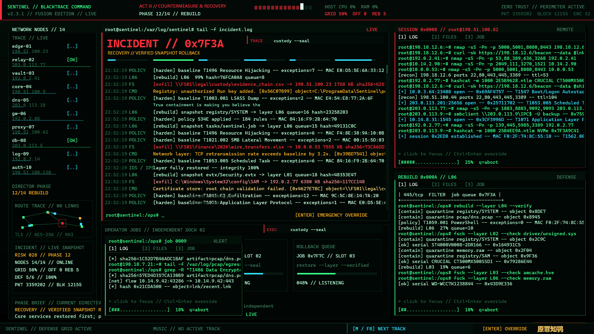

# Sentinel Blacktrace Command

[**English**](README.md) | [中文](README.zh.md)

> Make an idle PC drop the jaw of the coworker, classmate, or family member who keeps looking over your shoulder.

**Kimi 3.1 Pro Edition · v2.3.1**

When someone walks past your desk, or sees the classroom screen playing this, they will briefly think your machine is actually being compromised: confused, tense, not sure what to do. Friends who know the genre will just say: that is cool.

This is not a video. It is a tiny native Windows screen saver / prank built with C++17, Win32, and GDI. No Electron, no WebView, no Python, no network, no administrator rights.

> **Pure simulation.** It does not encrypt, delete, lock, or modify your system. The `1984` prompt only dismisses the simulation.



---

## Download

Get the latest release:

- **Chinese edition:** `Sentinel-v2.3.1-zh.zip`
- **English edition:** `Sentinel-v2.3.1-EN.zip`

[Download from Releases](https://github.com/FYZB2020/sentinel-blacktrace-command/releases/latest)

> Extract the whole zip first. `config.ini`, `zlib1.dll`, `music/`, and the executable must stay in the same folder.

---

## Quick start

1. Extract the zip.
2. Double-click `Sentinel-v2.3.1-EN.exe` (recommended).
3. Press **Enter** to open the containment window.
4. Enter the default override code **1984**, then **Enter** to exit.
5. Press **Ctrl + Shift + Q** at any time to force quit.

> On some machines `.scr` is associated with AutoCAD or another app. Prefer the `.exe`; use `install.bat` only when you want to register it as a Windows screen saver. Do not change the `.scr` association.

---

## Install as a Windows screen saver (optional)

1. Extract the zip.
2. Right-click `install.bat` → **Run** (normal user; no admin required).
3. Windows opens the screen-saver settings; select `Sentinel-v2.3.1-EN`.
4. The English edition installs to `%LOCALAPPDATA%\Sentinel-EN`; the Chinese edition uses `%LOCALAPPDATA%\Sentinel`. They can coexist without overwriting each other.

### Idle activation: IdleMinutes

Default `IdleMinutes=0`: **double-click only, no auto-start**.

To start after idle time:

1. Install once.
2. Edit `%LOCALAPPDATA%\Sentinel-EN\config.ini`.
3. Set `IdleMinutes=5`, `10`, `15`, `60`, `120`, `180`, or any integer `1..1440`.
4. Run the same `install.bat` again. It writes the native Windows timeout as `IdleMinutes × 60` seconds.

> The program does not run a background idle watcher. Windows stores the screen-saver timeout in the registry; the installer syncs the INI value there.

### Uninstall

Run `uninstall.bat`, or choose another screen saver in Windows settings. The English uninstaller only removes `Sentinel-EN` and its own registry value; it leaves the Chinese edition alone.

---

## Controls

| Key | Action |
| --- | --- |
| `Enter` | Open the override window; when a fake console input is focused, submit the fake command |
| `Ctrl + Enter` | Open the override window while typing in a fake console |
| `Esc` | Close the override window (unless lockdown is active) |
| `Backspace` | Edit fake console input |
| `F5` | Reload `config.ini` |
| `F6` | Preview the next layout (does not write the INI) |
| `F7` | Preview the next attack goal (does not write the INI) |
| `F8` / `M` | Next music track |
| Mouse click | Focus a console; click `[1] [2] [3]` to switch pages |
| Hidden bottom-right hotspot | Next music track |
| `Ctrl + Shift + Q` | Exit immediately |

The fake consoles accept typing, Enter, page tabs, and a fake file tree, but **no real command is executed**. Input is washed away by the live stream; if a window closes, unfinished input disappears with it.

---

## Override code

Default: **1984**

```ini
[general]
Code=1984
```

Rules:

- 4–32 printable ASCII characters
- case-sensitive
- no spaces
- letters, digits, and symbols are allowed
- reload with `F5` or restart after editing

Forgot it? `Ctrl + Shift + Q` or Task Manager. Nothing is really locked.

---

## Seven layouts

| Layout | Focus |
| --- | --- |
| `terminal` | Left node rail + main terminal + two telemetry consoles |
| `split` | Two large terminals; attack and defense streams separated |
| `boundary` | Orbital boundary interception, target lock, purge |
| `warroom` | Target queue, central radar, remote evidence stream |
| `forensic` | Evidence tree, custody timeline, exfil ledger |
| `containment` | Six defense lanes and the auto-defense pipeline |
| `blackbox` | Minimal black, huge warning, sparse telemetry |

```ini
[general]
Theme=auto
```

`Theme=auto` rotates by act; use `terminal`, `split`, `boundary`, `warroom`, `forensic`, `containment`, or `blackbox` to pin one. `F6` previews a layout without writing the file.

---

## Music

Eight tracks ship in both editions:

1. `A sudden blow.mp3`
2. `A sudden blow (v2).mp3`
3. `The wheels of the world.mp3`
4. `The wheels of the world 2.59.mp3`
5. `The ghost in the machine v2.mp3`
6. `A wilderness of mirrors.mp3`
7. `Slouching towards Bethlehem.mp3`
8. `Slouching towards Bethlehem V2.mp3`

- `F8` / `M` / hidden bottom-right hotspot: next track
- `Music=on|off` mutes the music layer
- `MusicDir=music` points at the folder
- Drop your own `.mp3` / `.wav` files into `music/`; they are discovered on restart
- Screenshot and benchmark modes never start music

```ini
[music]
Music=on
MusicDir=music
```

---

## Sound and effects

```ini
[effects]
Sound=on
Flash=med
Shake=0
Glitch=1
ErrorText=1
Dust=med
Corruption=med
Motion=full
```

- `Sound=on|off`: beeps, alarms, typing
- `Shake=0`: screen shake is removed in this build; the key remains for old configs
- `Flash=low|med|high`: flash intensity
- `ErrorText=1`: glitch text and corrupt typography
- `Dust=off|low|med|high`: background dust/noise
- `Corruption=low|med|high`: screen tearing, red damaged windows
- `Motion=full|reduced`: reduce motion for remote desktop or low-end machines

Photosensitive users: use `Flash=low` and `Motion=reduced`.

---

## Quotes

The English edition uses `quotes-en.txt`; the Chinese edition uses `quotes.xlsx`.

Quotes appear as ghost text: typewriter reveal, then the beginning erases while the rest continues, and the line occasionally cuts into the live stream. No boxes, no spam.

```ini
[quotes]
Quotes=on
QuotesFile=quotes-en.txt
```

Replace it with your own UTF-8 `.txt` or `.xlsx`; if the file is missing or malformed, the program falls back silently to its built-in small corpus.

---

## Troubleshooting

**Double-click does nothing / flashes once**
- Wait 1–2 seconds for the short boot.
- Press `Ctrl + Shift + Q`; try `--windowed`.
- Keep the exe, `config.ini`, `zlib1.dll`, and `music/` together.

**`.scr` does not open**
- `.scr` may be associated with AutoCAD. Use the exe or `install.bat`; do not change the association.

**No sound / no music**
- Check `Sound=on` and `Music=on`.
- Check `music/` for at least one `.mp3` / `.wav`.
- Some remote desktops and machines without an audio device disable playback.

**No ghost quotes**
- Check `Quotes=on` and `QuotesFile`.
- `quotes.xlsx` must be a valid xlsx; `quotes-en.txt` must be UTF-8.
- Missing files fall back silently.

**Forgot the code**
- Default is `1984`; use `Ctrl + Shift + Q` or Task Manager if you changed it.

**Antivirus warning**
- No network, no system-folder writes, no admin, no process injection.
- A full-screen topmost screen saver that blocks close can still look suspicious to EDR. Read this README, confirm it is the simulation, then allow it.

---

## Build from source

```
sentinel-blacktrace-command/
  zh/   # Chinese build
  en/   # English build
  docs/
```

Each edition contains:

```
src/            C++17 source
tools/          build.ps1 / install.ps1 / uninstall.ps1
config.ini      default config
quotes.xlsx     Chinese quotes (zh only)
quotes-en.txt   English quotes (en only)
zlib1.dll       xlsx decompression
music/          track folder (MP3s are in release zips, not in git)
```

Build with Windows 10/11 + VS 2022 Build Tools:

```powershell
cd en
powershell -NoProfile -ExecutionPolicy Bypass -File .\tools\build.ps1
```

Output goes to `dist/`. The build script runs selftest, benchmark, contentcheck, and musiccheck; any failure aborts the build.

> The repository does not commit the eight MP3s (size and rights). They are included in the release zips. Add music you have the right to use when building from source. The build runs musiccheck and needs at least two tracks to pass, or temporarily comment out the musiccheck line in `tools/build.ps1`.

---

## How this was made

This is the **Kimi 3.1 Pro Edition**.

- The framework started from **DeepSeek Fresh 1.4** (the project’s internal name).
- **Kimi 3.1 Pro** did the visual, interaction, English, and release pass — roughly **6 rounds** of conversation.
- **GLM** joined for about **2 rounds** of direction. The GLM 5.4 Edition is a separate project with a different feel and a different way of thinking; it will be published next to this one. Check my [GitHub repositories](https://github.com/FYZB2020?tab=repositories) for the neighboring edition.
- Kimi used its cheapest Coding Plan (**¥50 / month**) and burned the whole quota; GLM used Trae’s Coding Plan (**¥40 / month**), also burned in one go.
- So this is not “one prompt, one video”. It is two models, many rebuilds, bug fixes, and a lot of small decisions that ended up as a runnable program.

---

## Signature and license

The persistent mark in the bottom-right corner is the artist signature:

`// 原罪知鸮`

It stays visible in every layout, under the containment modal, and in the English edition. Please keep it.

Source is released under a **Personal Use License**: use it, modify it, learn from it; do not resell it, do not remove the signature and republish, do not claim it as your own. Music and quote rights remain with their original creators. See [LICENSE](LICENSE).

---

## Final note

If it makes a coworker freeze for three seconds, or a friend ask “what is that?”, it worked.

> Again: this is a simulation. Real security does not come from a screen saver.
