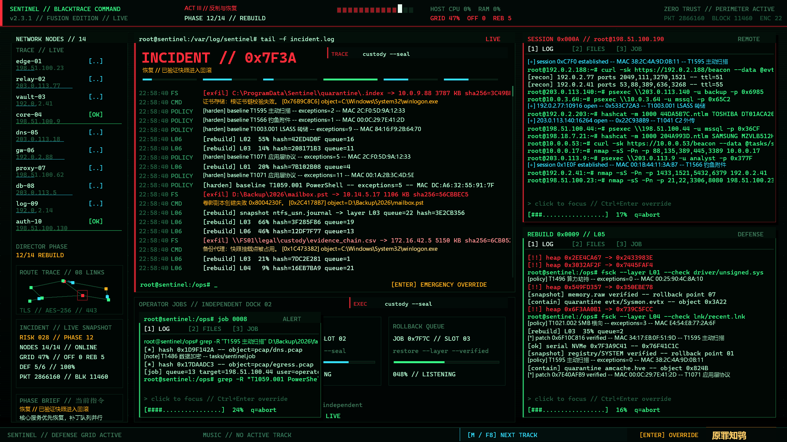

# Sentinel Blacktrace Command

> 让空闲的电脑，惊掉喜欢窥屏的同事、同学和家人的下巴。

**Kimi 3.1 Pro Edition · v2.3.1**

当有人路过你的工位，或者在教室、宿舍、聚会现场看到这块屏幕正在播放，他们会短暂地以为你的电脑真的被入侵了：困惑、紧张、不知所措。懂行的朋友则会觉得——这玩意儿真酷。

它不是一段视频，而是一个很小的原生 Windows 屏保/整蛊程序：纯 C++17、Win32、GDI，没有 Electron，没有 WebView，没有 Python，不联网，不需要管理员权限。

> **这是纯模拟。** 不会加密、删除、锁死或修改你的系统。底部的 `1984` 只是解除模拟，不是真实后门。



---

## 下载

在 [Releases](https://github.com/FYZB2020/sentinel-blacktrace-command/releases/latest) 下载：

| 版本 | 文件 | 说明 |
| --- | --- | --- |
| 中文版 | `Sentinel-v2.3.1-zh.zip` | 中文界面、中文引文、中文 README |
| English Edition | `Sentinel-v2.3.1-EN.zip` | 全英文界面与引文；只有艺术签名保留中文 |

> 请先完整解压，再运行 exe。`config.ini`、`zlib1.dll`、`music/` 和程序必须在同一层目录。

---

## 30 秒上手

1. 解压下载的 zip。
2. 双击 `Sentinel-v2.3.1.exe`（推荐）；英文版双击 `Sentinel-v2.3.1-EN.exe`。
3. 按 **Enter** 打开收容窗口。
4. 输入默认覆盖码 **1984**，再按 **Enter**，退出。
5. 任何时候按 **Ctrl + Shift + Q** 强制退出。

> 本机的 `.scr` 文件关联可能被 AutoCAD 等软件占用。**优先双击 exe**；需要注册成 Windows 屏保时，运行 `install.bat`，不要改 `.scr` 关联。

---

## 安装成 Windows 屏保（可选）

1. 解压后右键 `install.bat` → **以普通用户身份运行**（不需要管理员）。
2. Windows 会打开“屏幕保护程序设置”；选中 `Sentinel-v2.3.1` 或 `Sentinel-v2.3.1-EN`。
3. 中文版安装到 `%LOCALAPPDATA%\Sentinel`；英文版安装到 `%LOCALAPPDATA%\Sentinel-EN`。两个版本可以同时存在，互不覆盖。
4. 安装器会复制程序、`config.ini`、引文文件、`zlib1.dll` 和 `music/`。

### 自动进入屏保：IdleMinutes

默认 `IdleMinutes=0`：**只能双击启动，不自动进入**。

想让电脑闲置一段时间后自动进入：

1. 先安装一次。
2. 中文版编辑 `%LOCALAPPDATA%\Sentinel\config.ini`；英文版编辑 `%LOCALAPPDATA%\Sentinel-EN\config.ini`。
3. 把 `IdleMinutes=0` 改成：
   - `5` / `10` / `15` / `60` / `120` / `180`（分钟）
   - 或任意 `1..1440` 的整数
4. 重新运行同一个版本的 `install.bat`。安装器会写入 Windows 原生屏保等待时间 `IdleMinutes × 60` 秒。

> 为什么不能只改 INI？Windows 的屏保等待时间存在注册表里，安装器负责把 INI 的值同步过去。程序本身不会常驻后台监控空闲时间。

### 卸载

运行对应版本的 `uninstall.bat`，或在“屏幕保护程序设置”里换回其他屏保。卸载器只清理当前版本的安装目录和 HKCU 屏保项，不碰 `.scr` 关联。

---

## 操作

| 按键 | 动作 |
| --- | --- |
| `Enter` | 打开覆盖窗口；当某个假控制台输入框被选中时，提交假输入 |
| `Ctrl + Enter` | 在假控制台输入状态下打开覆盖窗口 |
| `Esc` | 关闭覆盖窗口（锁定倒计时期间除外） |
| `Backspace` | 编辑假控制台输入 |
| `F5` | 重新读取 `config.ini` |
| `F6` | 预览下一个布局（不写回 INI） |
| `F7` | 预览下一个攻击目标（不写回 INI） |
| `F8` / `M` | 下一首音乐 |
| 鼠标点击 | 选中控制台窗口；点击标题栏 `[1] [2] [3]` 切页 |
| 屏幕右下角隐藏热区 | 下一首音乐 |
| `Ctrl + Shift + Q` | 立即退出 |

假控制台里可以打字、按 Enter、切换页面、展开假文件树，但**不会执行任何真实命令**。输入会被自动滚动的日志冲走；窗口关闭时未完成的输入也会一起消失。

---

## 密码 / 覆盖码

默认：**1984**

在 `config.ini` 修改：

```ini
[general]
Code=1984
```

规则：

- 4–32 个可打印 ASCII 字符
- 区分大小写
- 不能包含空格
- 支持字母、数字和符号，不再局限于 4 位数字
- 修改后按 `F5` 或重启程序

如果忘了密码：`Ctrl + Shift + Q` 或任务管理器结束进程即可。它不会真的锁死系统。

---

## 七个布局

| 布局 | 视觉重点 |
| --- | --- |
| `terminal` | 左侧节点栏 + 主终端 + 两个遥测控制台 |
| `split` | 左右双终端，攻防日志分离 |
| `boundary` | 轨道/边界拦截、目标锁定与清除 |
| `warroom` | 目标队列、中心雷达、远程证据流 |
| `forensic` | 文件证据树、证据时间线、外泄账本 |
| `containment` | 六层防线、自动处置流水线、逐层修复 |
| `blackbox` | 极简黑底、巨大的中文告警、稀疏遥测 |

`config.ini`：

```ini
[general]
Theme=auto
```

- `Theme=auto`：按剧情轮换
- `Theme=terminal` 等：固定一个布局
- `F6`：即时预览下一个布局

---

## 音乐

两个版本都带 8 首曲目：

1. `A sudden blow.mp3`
2. `A sudden blow (v2).mp3`
3. `The wheels of the world.mp3`
4. `The wheels of the world 2.59.mp3`
5. `The ghost in the machine v2.mp3`
6. `A wilderness of mirrors.mp3`
7. `Slouching towards Bethlehem.mp3`
8. `Slouching towards Bethlehem V2.mp3`

- `F8` / `M` / 右下角隐藏热区：切歌
- `config.ini` 中 `Music=on|off` 控制音乐层
- `MusicDir=music` 指定音乐目录
- 把自己的 `.mp3` / `.wav` 放进 `music/`，重启后自动发现
- 截图/基准测试模式不启动音乐，避免测试时出声

```ini
[music]
Music=on
MusicDir=music
```

---

## 声音与特效

```ini
[effects]
Sound=on
Flash=med
Shake=0
Glitch=1
ErrorText=1
Dust=med
Corruption=med
Motion=full
```

- `Sound=on|off`：提示音、报警、打字声
- `Shake=0`：本版已移除屏保抖动；保留该键只为兼容旧配置
- `Flash=low|med|high`：闪屏强度
- `ErrorText=1`：故障文字/文字撕裂
- `Dust=off|low|med|high`：背景尘埃/噪点
- `Corruption=low|med|high`：花屏、撕裂、红色受损窗口
- `Motion=full|reduced`：减少动效，适合远程桌面/低性能机器

光敏人群建议 `Flash=low`、`Motion=reduced`。

---

## 引文

- 中文版：`quotes.xlsx`
- 英文版：`quotes-en.txt`
- 引文会以“幽灵文字”的形式短暂出现：打字机式出现、向后擦除，并偶尔插入实时数据流
- 不会刷屏，也不会成为固定 UI

```ini
[quotes]
Quotes=on
QuotesFile=quotes.xlsx
```

英文版：

```ini
[quotes]
Quotes=on
QuotesFile=quotes-en.txt
```

替换成自己的 `.xlsx`（共享字符串）或 UTF-8 `.txt` 即可。文件缺失或损坏时自动回退到程序自带的小型引文库。

---

## 故障排查

**双击没反应 / 只闪一下**
- 先等 1–2 秒；启动有很短的 BIOS/攻击开场。
- 按 `Ctrl + Shift + Q`；再试 `--windowed`。
- 检查 exe、`config.ini`、`zlib1.dll`、`music/` 是否在同一层目录。

**`.scr` 打不开**
- 你的 `.scr` 关联可能属于 AutoCAD。用 exe 或 `install.bat`，不要改文件关联。

**没有声音 / 没有音乐**
- 检查 `Sound=on`、`Music=on`。
- 检查 `music/` 是否存在且至少有 1 首 `.mp3`/`.wav`。
- 某些远程桌面/无声卡环境会禁用音频。

**没有幽灵引文**
- 检查 `Quotes=on`、`QuotesFile` 路径。
- `quotes.xlsx` 必须是正常的 xlsx；`quotes-en.txt` 必须是 UTF-8。
- 文件缺失时不会报错，只会静默回退。

**密码忘了**
- 默认 `1984`；如果改过，按 `Ctrl + Shift + Q` 或任务管理器退出，再改 `config.ini`。

**公司电脑/杀毒软件报警**
- 程序不联网、不写系统目录、不申请管理员、不注入其他进程。
- 但屏保会全屏置顶并拦截关闭，某些 EDR 可能把它当可疑程序。先看 README，确认是模拟再放行。

---

## 从源码构建

```
sentinel-blacktrace-command/
  zh/   # Chinese build
  en/   # English build
  docs/
```

每个目录里：

```
src/            C++17 源码
tools/          build.ps1 / install.ps1 / uninstall.ps1
config.ini      默认配置
quotes.xlsx     中文引文（仅中文版）
quotes-en.txt   英文引文（仅英文版）
zlib1.dll       读取 xlsx 所需
music/          曲目目录（仓库不提交 mp3，发布 zip 内带 8 首）
```

编译（Windows 10/11 + VS 2022 Build Tools）：

```powershell
cd zh
powershell -NoProfile -ExecutionPolicy Bypass -File .\tools\build.ps1
```

英文版：

```powershell
cd en
powershell -NoProfile -ExecutionPolicy Bypass -File .\tools\build.ps1
```

输出在各自的 `dist/`。构建脚本会跑 selftest、benchmark、contentcheck 和 musiccheck；任何一项失败都会中止。

> 仓库不提交 8 首 MP3（体积与版权归属原因）。发布 zip 里已经包含；从源码构建时，把你有权使用的音乐放进 `music/`。构建脚本会跑 musiccheck，至少放两首才能通过，或者把 `tools/build.ps1` 里的 musiccheck 一行临时注释掉。

---

## 版本说明与制作过程

这一版是 **Kimi 3.1 Pro Edition**。

- 底层框架从 **DeepSeek Fresh 1.4** 起步（按项目内的称呼）。
- **Kimi 3.1 Pro** 完成了视觉、交互、英文版与发布整理的集中打磨，大约来回 **6 轮**对话。
- **GLM** 也参与了方向讨论，大约 **2 轮**对话；GLM 5.4 Edition 是另一个独立项目，思路和效果会不一样，后续会单独发布。发布后可在我的 [GitHub 仓库列表](https://github.com/FYZB2020?tab=repositories) 找到“隔壁”的那一版。
- Kimi 这边用的是最便宜的 Coding Plan（**50 元/月**），额度直接烧完；GLM 用的是 Trae 的 Coding Plan（**40 元/月**），也是一口气烧完。
- 所以，这不是“一个提示词生成一个视频”，而是两个模型、几百轮构建/修 bug/重编译之后留下的一套可运行程序。

---

## 签名与授权

右下角常驻的 **原罪知鸮** 是作者签名，也是防盗版标记：

`// 原罪知鸮`

它会在所有布局、收屏窗口和英文版里一直显示。请保留它。

代码以“个人使用许可”发布：可以个人使用、修改、学习；不得直接转售、不得去掉签名后重新发布、不得把作者作品说成自己的。音乐与引文的权利归各自原作者；如果你要再分发，请先确认你有权使用它们。完整条款见 [LICENSE](LICENSE)。

---

## 最后

如果它让你同事愣了三秒，或者让你朋友问“这什么程序”，那它就成功了。

> 再次提醒：这是模拟。真正的安全，不要靠屏保。
